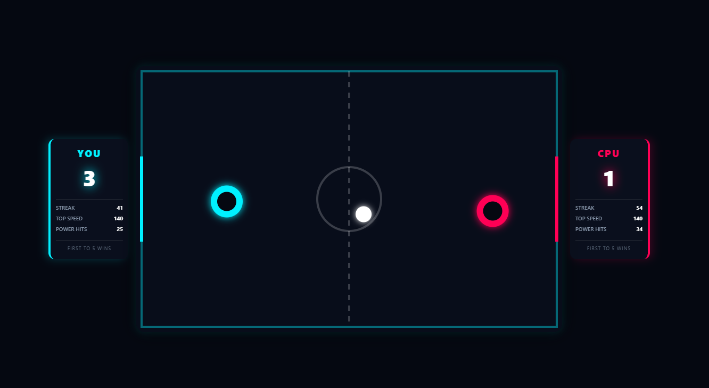

<div align="center">

  # 🏒 AIR HOCKEY GAME

  **Uma experiência arcade com estética neon.**

  
  
  
  

  

  <br><br>

  [](https://air-hockey-game-eight.vercel.app/)

</div>

---

## 🎮 Sobre o projeto

O **AIR HOCKEY GAME** é um jogo 2D inspirado nas clássicas mesas de air hockey, desenvolvido utilizando HTML5 Canvas e JavaScript Vanilla.

Com uma identidade visual futurista, o jogo apresenta uma arena com iluminação neon, efeitos sonoros, física de colisões e partidas contra um adversário controlado pelo computador.

Este projeto representa um marco especial na minha trajetória como desenvolvedora: foi o primeiro jogo que desenvolvi, com o objetivo de explorar a programação de jogos e transformar meus conhecimentos em uma experiência interativa.

## ⚡ Funcionalidades

- Partidas contra inteligência artificial (CPU).
- Física de movimento e colisões.
- Sistema de pontuação em tempo real.
- Interface com efeitos de iluminação neon.
- Animações e feedbacks visuais.
- Efeitos sonoros utilizando Web Audio API.
- Estatísticas individuais dos jogadores.
- Sistema de vitória ao atingir cinco pontos.

## 🕹️ Como jogar

O objetivo é rebater o disco e marcar gols na área do adversário, enquanto protege seu próprio gol.

O primeiro jogador a atingir cinco pontos vence a partida.

### Estatísticas da partida

| Estatística | Descrição |
|---|---|
| Score | Pontuação do jogador |
| Streak | Sequência registrada |
| Top Speed | Velocidade máxima registrada |
| Power Hits | Rebatidas de maior potência |

## 💻 Tecnologias utilizadas

| Tecnologia | Aplicação |
|---|---|
| HTML5 | Estrutura do jogo |
| Canvas API | Renderização da arena e dos elementos |
| CSS3 | Interface, animações e efeitos neon |
| JavaScript Vanilla | Lógica, física e comportamento da CPU |
| Web Audio API | Efeitos sonoros |
| Vercel | Hospedagem e publicação |

## 🎨 Identidade visual

A direção visual foi inspirada em jogos arcade futuristas, utilizando uma composição minimalista com alto contraste.

- Azul ciano neon para o jogador.
- Rosa neon para o adversário.
- Fundo escuro para destacar os elementos.
- Efeitos luminosos e interface de estatísticas.

## 📂 Estrutura do projeto

```text
air-hockey-game/
├── index.html
├── gameplay.png
└── README.md
```

## 🚀 Como executar localmente

Clone o repositório:

```bash
git clone https://github.com/truemelloo/air-hockey-game.git
```

Abra o arquivo `index.html` no navegador.

Não é necessário instalar dependências ou frameworks.

## 📚 Aprendizados

Durante o desenvolvimento deste projeto, explorei conceitos como:

- Lógica de programação aplicada a jogos.
- Desenvolvimento de interfaces interativas.
- Renderização gráfica com Canvas.
- Detecção de colisões.
- Física de movimento.
- Comportamento de adversários controlados pelo computador.
- Manipulação de áudio e animações.

Por ser meu primeiro jogo, este projeto representa o início da minha jornada no desenvolvimento de experiências interativas e jogos digitais.

## 👩🏻‍💻 Desenvolvedora

**Ana Clara Mello**

Designer Gráfica & Desenvolvedora em formação.

Estudante do curso Técnico em Desenvolvimento de Sistemas — ETEC.

[](https://github.com/truemelloo)
[](https://www.linkedin.com/in/anaclarasouzamello/)
[](https://www.instagram.com/truemelloo/)

---

<div align="center">

  **Meu primeiro jogo. O início de uma grande jornada.**

  Desenvolvido com criatividade, tecnologia e dedicação. 💜

  ⭐ Se gostou do projeto, deixe uma estrela!

</div>
